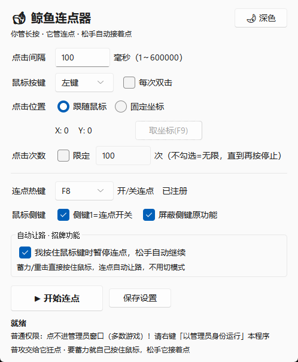
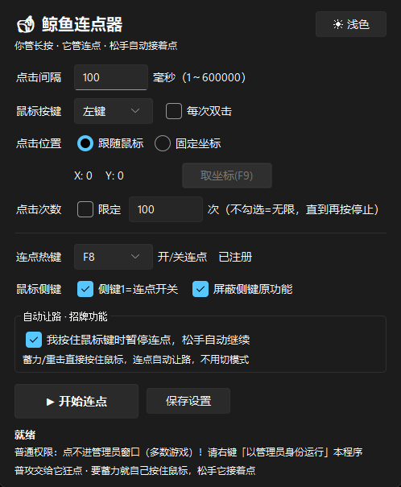

# 🐋 whale-clicker

**You handle the holding, it handles the clicking — release and it picks right back up.**

A Windows auto-clicker built for *alternating* rapid clicks and long holds (inspired by 鼠大侠 / Mouse Hero, redesigned for unpredictable alternation, e.g. action games where you spam attacks and charge skills in no fixed pattern).

Pure Python standard library via ctypes (SendInput / RegisterHotKey / SetWindowsHookEx), UI in tkinter + [sv-ttk](https://github.com/rdbende/Sun-Valley-ttk-theme) modern theme (light/dark toggle). No network, no registry writes, no telemetry.

 

## Signature feature: auto-yield

Ordinary clickers keep injecting clicks while you hold the button to charge, fighting your real input. whale-clicker watches your **real** button presses:

- You hold left/right/middle → clicking **pauses instantly** (your real clicks pass through untouched);
- You release → clicking **resumes automatically**;
- Multiple buttons held: resumes only when all are released;
- Don't want it? One checkbox turns it off.

Its own injected clicks carry the injected flag and are ignored by its own hook — it never pauses itself.

## Features

| Item | Detail |
|------|--------|
| Interval | 1–600000 ms |
| Button | left / right / middle |
| Double-click per tick | optional |
| Position | follow cursor / fixed point (3s countdown capture) |
| Count | infinite or limited, auto-stop |
| Toggle | **F8** (F1–F12 configurable) or **mouse side button 1**, global hotkey |
| Side buttons | side1 = toggle; can disable; can swallow original side-button function |
| Auto-yield | pause on real hold, resume on release; optional |
| Theme | light / dark, remembered |
| Settings | auto-saved to `config.json` next to the exe |

## Download

Grab `鲸鱼连点器.exe` from [Releases](../../releases) and run it. Accept the UAC prompt once — **administrator rights are required** to click into games that run elevated (Windows UIPI).

> Unsigned PyInstaller one-file exes may trigger heuristic AV warnings; the source is fully open — audit it or build from source below.

## Run / build from source

Windows + Python 3.10+ (developed on 3.14).

```powershell
pip install -r requirements.txt   # sv-ttk only; pyinstaller + pillow for packaging
python src\app.py
.\build.ps1                       # one-file exe -> dist\鲸鱼连点器.exe
python tests\test_basic.py        # side-effect-free self-test, sends no real clicks
```

## Not working in a game?

Most games run elevated; Windows UIPI blocks simulated input from non-elevated processes (hotkey reacts, game doesn't click). Run this tool elevated — the exe already requests it. Still nothing? The game may read the mouse via DirectInput or run anti-cheat that ignores injected clicks.

## Disclaimer

- Using auto-clickers in games may violate their terms of service — **at your own risk**; some online games explicitly ban such tools.
- For learning and personal assistance only; the author is not liable for consequences.

## License

MIT © xsllo425