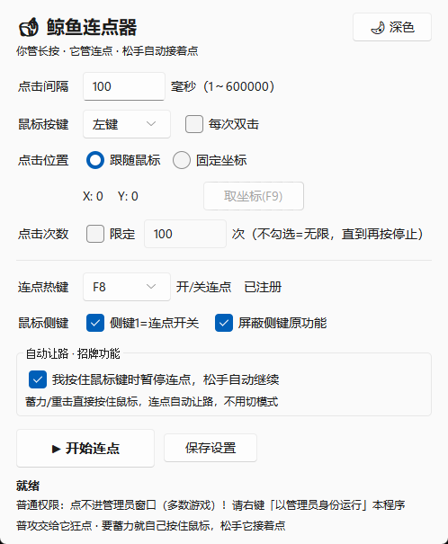
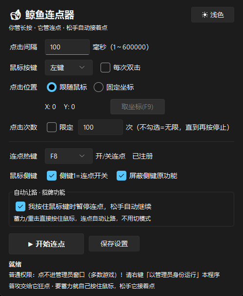

# 🐋 鲸鱼连点器 whale-clicker

**你管长按，它管连点，松手自动接着点。**

一个为「连点和长按交替使用」而生的 Windows 鼠标连点器（灵感来自鼠大侠，但交互为无规律交替重新设计）。
普攻连点到一半要蓄力？直接按住鼠标就行——连点自动让路，松手自动接着点，全程不用切模式、不用碰界面。

纯 Python 标准库 ctypes 直调 Windows API（SendInput / RegisterHotKey / SetWindowsHookEx），
界面用 tkinter + [sv-ttk](https://github.com/rdbende/Sun-Valley-ttk-theme) 现代主题（深/浅一键切换）。
不联网、不写注册表、不收集任何数据。

 

## 招牌功能：自动让路

普通连点器在你按住鼠标蓄力时还在疯狂注入点击，跟你的真实操作打架。鲸鱼连点器监听你的**真实按住**：

- 你按住左/右/中键 → 连点**立即暂停**（你的真实点击原样放行，游戏照常收到）；
- 你松手 → 连点**自动恢复**，接着刚才的节奏点；
- 多键同按也认：都松手才恢复；
- 不想要？一个勾选关掉，回到普通连点器。

它自己的注入点击带注入标记，会被自己忽略，不会「自己让自己暂停」。

## 功能一览

| 项目 | 说明 |
|------|------|
| 点击间隔 | 1～600000 毫秒 |
| 鼠标按键 | 左 / 右 / 中键 |
| 每次双击 | 每个间隔连发两下（仅连点） |
| 点击位置 | 跟随鼠标 / 固定坐标（3 秒倒计时取坐标） |
| 点击次数 | 无限循环，或限定次数点够自动停 |
| 连点开关 | 默认 **F8**；点击热键按钮后按下单键或组合键，也可使用**鼠标侧键1** |
| 鼠标侧键 | 侧键1=连点开关；可整体关闭；可屏蔽侧键原功能（不触发浏览器后退） |
| 自动让路 | 真实按住暂停、松手恢复，可关 |
| 主题 | 深色 / 浅色一键切换，记住偏好 |
| 设置保存 | 关闭时自动存 `config.json`（exe 旁） |

## 下载与运行

到 [Releases](../../releases) 下载 `whale-clicker.exe`，双击运行。
启动时弹一次 UAC 提权确认，点「是」——**必须管理员权限**才能点进以管理员身份运行的游戏（Windows UIPI 限制）。

> 杀毒软件可能对未签名的 PyInstaller 单文件 exe 报启发式警告；源码完全公开，可自行审查或按下面步骤从源码打包。

## 为什么弹「Windows 已保护你的电脑」？

exe **没有代码签名**（个人开源项目不买签名证书），而从浏览器下载的副本带「来自互联网」标记（Mark of the Web）。两者叠加，SmartScreen 就会弹蓝色警告。这是**信誉检查，不是查毒**。

过掉它（任选其一）：

- 蓝框上点 **更多信息 → 仍要运行**（对该文件记住一次即可）；
- 或右键 exe → **属性** → 勾选底部 **解除锁定** → 确定，去掉下载标记，之后不再弹。等价命令：`Unblock-File .\whale-clicker.exe`。

注意和另一个弹窗区分：本程序**每次启动**都请求管理员（点进游戏必需），所以每次都会弹 **UAC**「你要允许此应用对你的设备进行更改吗」——那是正常的、和 SmartScreen 是两回事，点「是」即可。

不想碰这些：用管理员终端从源码跑 `python src\app.py`，完全没有 SmartScreen。

## 从源码运行 / 打包

需要 Windows + Python 3.10+（开发用 3.14）。

```powershell
pip install -r requirements.txt   # 仅 sv-ttk；打包另需 pyinstaller、pillow
python src\app.py                 # 源码运行（游戏内需管理员终端）
.\build.ps1                       # 打包单文件 exe → dist\鲸鱼连点器.exe
python tests\test_basic.py        # 无副作用自测，不发任何真实点击
```

## 在游戏里不生效？

绝大多数游戏以管理员身份运行，普通权限进程的模拟输入会被 Windows UIPI 拦截——表现为热键有反应、游戏里点不动。用管理员身份运行本程序即可（exe 已内置提权请求）。
提权后仍不生效：该游戏可能用 DirectInput 读鼠标或带反作弊，会主动忽略注入点击。

## 免责声明

- 连点器用于游戏可能违反对应游戏的用户协议，**风险自负**；部分网游明确禁止此类工具。
- 本项目仅供学习与个人辅助用途，作者不对使用后果负责。
- 极高频率（间隔接近 1ms）时实际速率受系统与目标程序处理能力限制。

## 开发

- `src/core.py` —— 点击引擎 + 全局热键 + 鼠标低级钩子
- `src/app.py` —— tkinter + sv-ttk 界面
- `tests/test_basic.py` —— 9 组无副作用自测（CI 无桌面环境自动跳过真实钩子/界面组）
- `tools/make_icon.py` / `tools/screenshot.py` —— 图标与界面截图生成
- `.github/workflows/release.yml` —— 打 `v*` 标签自动自测 + 打包 + 发 Release

## License

MIT © xsllo425
